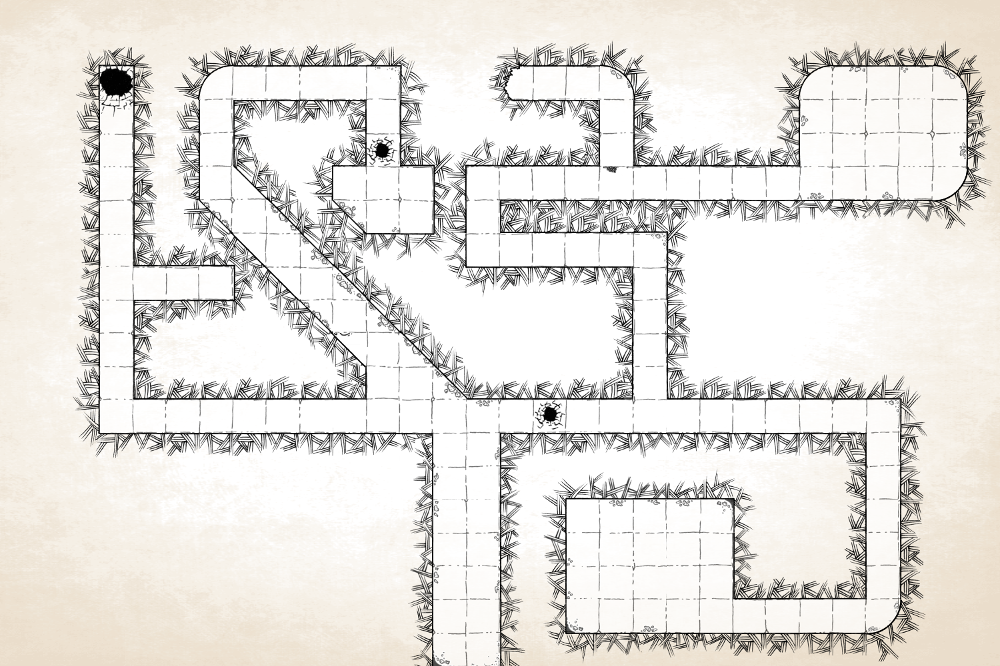
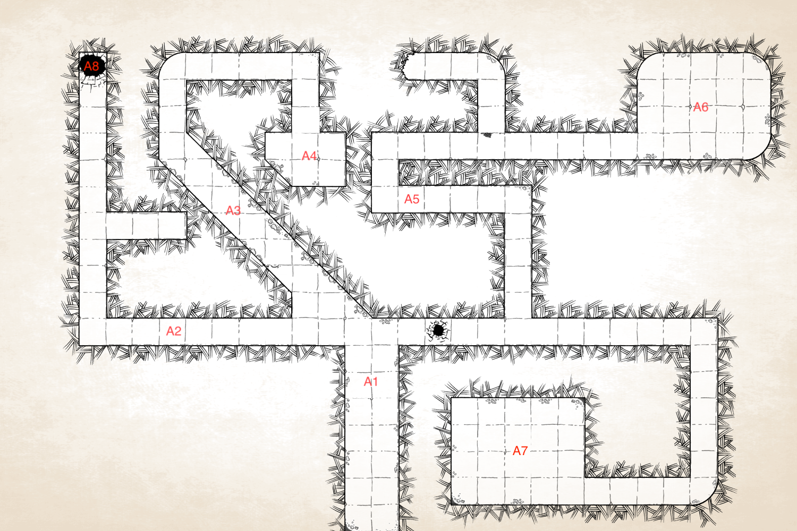
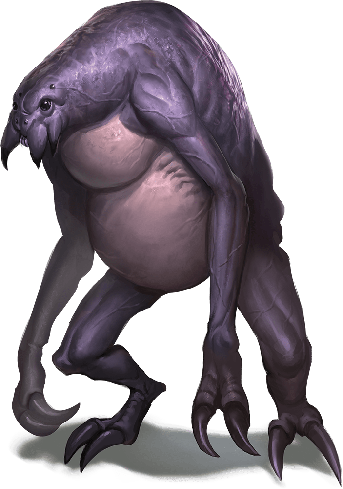
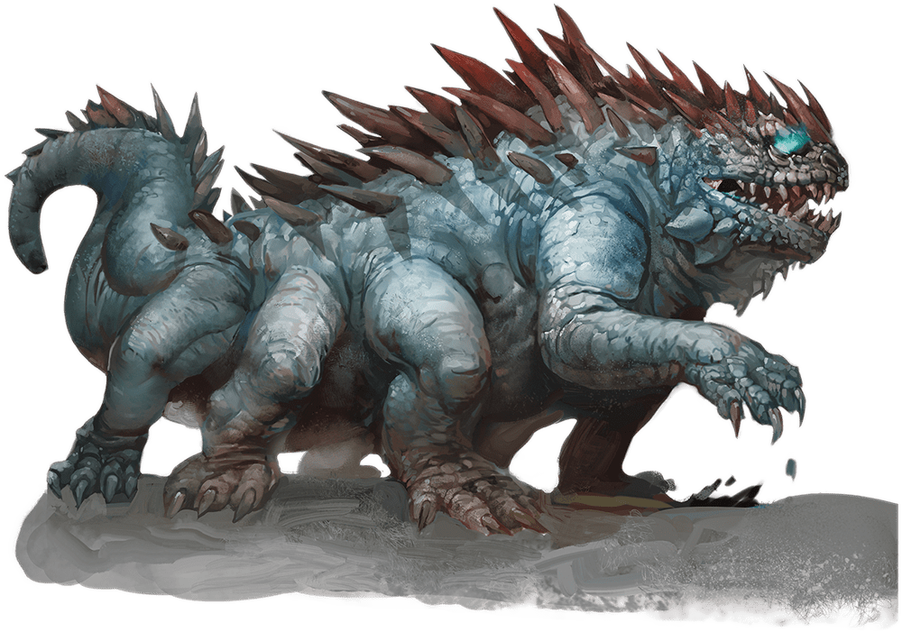
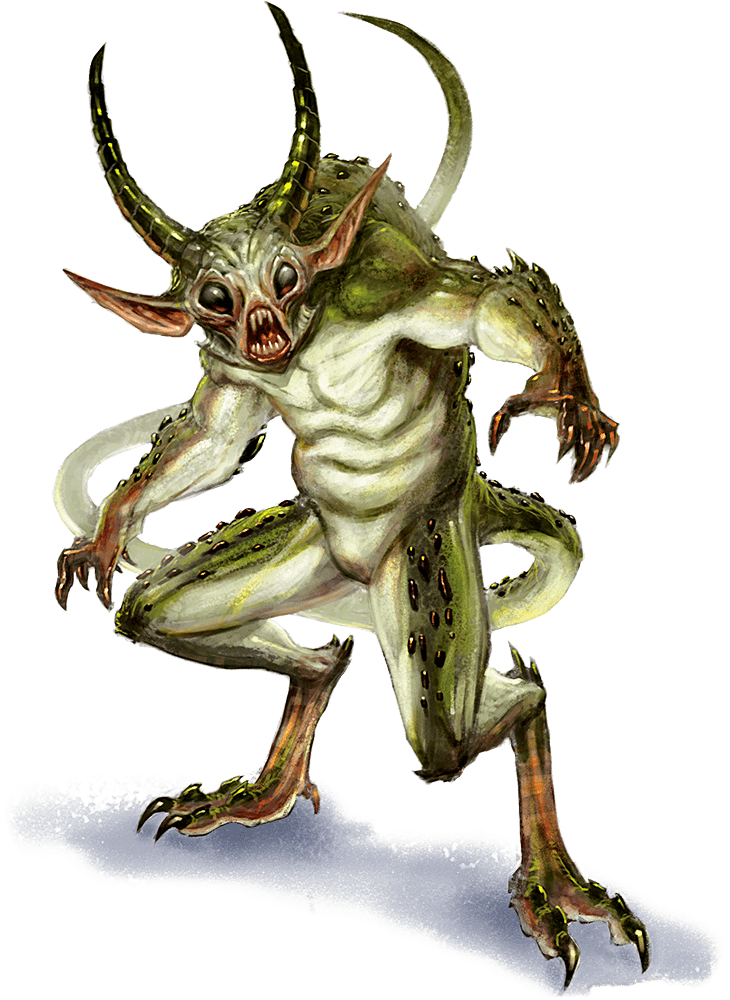
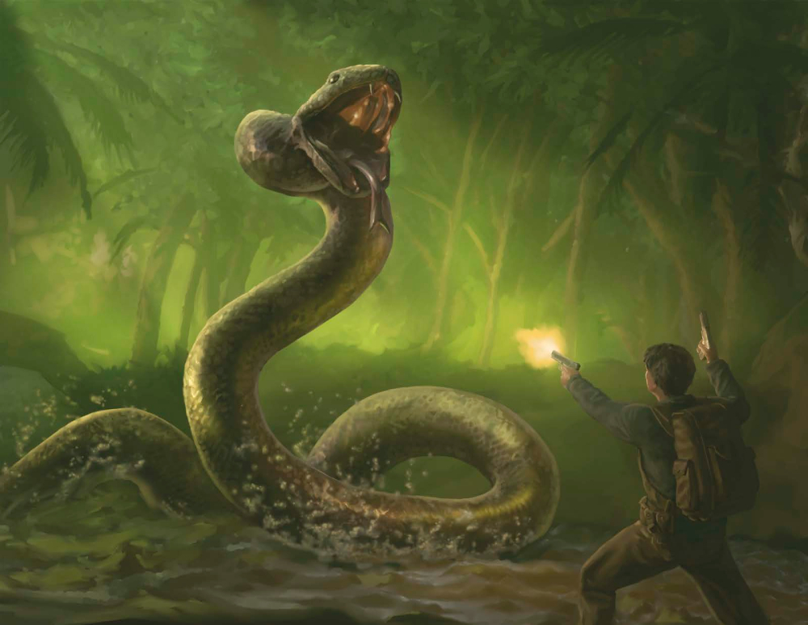

# Die Höhle des Schrecken

Dies ist eine Begegnung für Charaktere der Stufe 3-5. Sie ist kurz und lässt sich einfach in ein D&D-Abenteuer einbauen. Es beinhaltet alle Informationen die der SL braucht, um diese Begegnung auch reibungslos laufen zu lassen.

# Location Overview

Die Höhle von Cara’zac ist ein Gewölbe, das von uralten Wesen gebaut worden ist. Es befindet sich tief in einem Wald. Vor vielen vielen Jahren hat diese Höhle einer Bande von Partisanen als Unterschlupf gedient, aber nachdem sie aus der Gegend vertrieben worden sind, haben sie alles mitgenommen. Es wird aber noch gemunkelt, das dort ein riesiges Monster lebt, das von den Partisanen gezüchtet sein soll.

### Höhle-Merkmale

***Licht.*** In der Höhle ist es stockfinster. Man kann nur mit Nachsicht oder mit einer mitgebrachten Lichtquelle etwas sehen.

***Decke.*** Die Decken der Tunnels sind normalerweise 3 Meter hoch, außer bei Ausnahmen.

# Reise

Die Reise zur Höhle dauert, egal von wo, einen Tag. Sie führt die Charaktere vorbei an Wälder, Flüssen und Grasland. Auf der Reise treffen sie niemanden oder nichts. 

# Ankunft

Die Begegnung spielt in einer beliebigen Höhle. Sie ist eine typische Höhle aus Stein. Wenn die Charaktere bei der Höhle angekommen sind, ließ folgenden Text laut vor:

> Der Höhleneingang liegt still vor euch. Der Fels ist so geformt, dass er an den Kopf eines Drachen erinnert, mit groben Konturen für Maul und Augenhöhlen. Schon hier draußen auf, wie ungewöhnlich leise es ist. Kein Vogelruf, keine Bewegungen aus dem Wald – einfach nichts. Ein schwacher, fauliger Geruch strömt aus der Öffnung und erinnert an etwas, das schon länger verwest ist. Der Gang hinter dem Eingang führt schräg nach unten und wird schnell dunkler, je weiter er abfällt. An der Decke wachsen dünne Pflanzen, die leicht herabhängen. Einige von ihnen leuchten schwach, aber nicht genug, um den Gang wirklich zu erhellen. Die Felswände wirken feucht, und in der Luft liegt eine schwere Stille, als würde jeder Laut darin verschwinden.
> 

Unbeschriebene Karte der Höhle

Beschriebene Karte der Höhle

## Standorte

Die Folgenden Orte und Bereiche sind auf der Karte der Höhle eingezeichnet.

### A1: Eingang

Der Eingang der Höhle ist in einem großen Stein gehauen worden und hat die Form eines Drachenschädels. Von der Decke baumeln Pflanzen und Wurzeln, die aber sehr kurz sind (~10cm) Der Tunnel geht schräg hinab und ist extrem rutschig. Die Abenteurer müssen einen Geschicklichkeits-Wurf über SG 15 würfeln, um nicht auszurutschen. Wenn sie es nicht schaffen, bekommen sie 1-2 HP Schaden. 

Im Gang nach rechts ist direkt ein kleines Loch im Boden. Mit einem Wurf über SG 5 Weisheit, kann man das Loch sehen.

Versuchen die Charaktere aus der Höhle gehen wollen, treffen sie einen **Basilisk**, der von der Jagd zurückgekommen ist. Es versucht nach A5 zu kommen, aber es ist aggressiv auf die Charaktere. Das Monster kämpft bis zum Tod. 

### A2: Spinnweben-Gang

Überall im Gang hängen Spinnweben von der Decke, aber die Spinne ist weit und breit nicht zu sehen. Der Tunnel ist 2, 90 Meter hoch. Nach der Biegung kommt ein Gang der nach rechts abbiegt. 

***Treasure.*** Dort sind in einem Loch in der Wand, ca. auf Augenhöhe, 15 GM. Um das Loch zu entdecken, muss man über SG 12 Weisheit  würfeln. 

Am Ende des langen Ganges ist ein großes Loch im Boden. Wenn die Charaktere dort hineinfliegen kommen sie zu A8. Um das Loch zu sehen, muss ein Weisheits-Wurf über SG 6 getätigt werden.

### A3: Hauptgang

Die Höhe von diesem Tunnel beträgt 3 Meter und er besteht aus Stein. Regelmässig sind Stützen in den Stein gehauen worden. Sie sind aus Holz und schräg im Boden.

### A4: Lagerraum

Dieser Raum ist rechteckig und beinhaltet nichts außer kleine Steine, die verstreut am Boden liegen. In Raum ist ein **Atterkopp.**

### A5: “Blockade”

In diesem Tunnel patroulliert ein **Quasit** den Gang entlang. Sein Weg führt bis zum Anfang vom Bereich A1 bis zu A6. Nach den drei Kurven führt ein kleiner Gang weg. Nach einer Biegung nach links endet der Weg aprupt, weil dort der Tunnel eingestürzt ist. Unter Geröll und Schutt liegt ein Skelett eines Menschen. Es hat einen verwesten Fellmantel an, der aber sehr kaputt und schmutzig ist. Das einzige was die Leiche bei sich hat, ist eine Signalpfeife.  

### A6: Aufenthaltsraum

In der Mitte des Raumes steht ein Holztisch, darauf ein Tagebuch in einer, den Charakteren nicht bekannten, Sprachen. Es ist zerfleddert und sehr alt. Der Einband ist braun und auf dem Cover wurde ein fünfspitziger Stern gemalt. Es gibt keine Zeichnungen im Buch.

### A7: Schatzkammer

Dieser Raum wurde früher als Aufbewahrungsraum benutzt, doch als die Partisanen fliehen mussten, ließen sie ihre Schätze hier, damit sie die später holen konnten, eas sie aber nicht schafften, denn die Partisanen wurden hingerichtet.

       ***Trap.*** Vor der Schatzkammer gibt es eine Falle, die diese Kammer vor Eindringlingen                        schützen. Sie ist folgendermaßen aufgebaut: es gibt ein Seil, das 10cm über dem Boden                gespannt ist. Wenn es zu gespannt wird, schießen Pfeile aus den Wänden, aber nur auf ca.            Kopf- bis Kniehöhe. Um die Falle zu sehen: WIS SG 10. Um sie entschärfen zu können: INT             SG 8. 

***Treasure.*** In der rechten hinteren Ecke stehen zwei Holztruhen am Boden. Sie sind unversperrt und die erste ist 1 Meter lang, die zweite einen halben. In der einen liegt ein alter Lederbeutel mit 9 Edelsteine (Azurit und Obsidian), jeder davon ist 10 GM wert. Unteranderem befinden sich in der Kiste 2100 KM, 1400 SM und 60 GM und 20 Pfeile. In der zweiten Holztruhe sind magische Gegenstände: Zauberschriftrolle (Zaubergrad 2), Trank der Wasseratmung, Trank der Tierfreundschaft und Keoghtoms Salbe.

### A8: Wasserhöhle

Am Ende des Ganges bei A2 ist ein großes Loch im Boden. Man fällt in eine Höhle, die mit Wasser geflutet ist. Vom Wasser aus gesehen ist das Loch dann in der Decke. Die Wasserbecken ist 10 Meter tief (vom Wasserspiegel),6 Meter breit und vom Wasser zum Loch 4 Meter. Eine **Riesenwürgeschlange** lauert im Wasser. Die Hinweise darauf sind: eine, im Wasser, treibende Haut. Der einzige Ausweg aus der Höhle ist ein kleiner Tunnel am Grund des Beckens in die Wand geht. Er führt zur Oberfläche und endet in einem Erdloch, nahe der Höhle. Aus dem können die Charaktere einfach hinaus.

# Glossar

---

## **Atterkopp**

Mittelgroße Monstrosität, neutral böse

**Herausforderungsgrad:** 2 / 
**XP:** 450

**Rüstungsklasse:** 13 (Natürliche Rüstung)

**Trefferpunkte:** 44 (8W8 + 8)

**Geschwindigkeit:** 9

**Klettergeschwindigkeit:** 9

| **ST** | **GE** | **KO** | **IN** | **WE** | **CH** |
| --- | --- | --- | --- | --- | --- |
| +14 | +15 | +13 | +7 | +12 | +8 |

**Fertigkeiten:** Wahrnehmung: +3, Heimlichkeit: +4, Überlebenskunst: +3

**Sinne:** Dunkelsicht 18m, Passive Wahrnehmung 13

**Sprachen:** -

### **Eigenschaften**

### **Spinnenklettern**

Der Atterkopp kann schwierige Oberflächen erklimmen, auch kopfüber an der Decke, ohne eine Fähigkeitsprobe ablegen zu müssen.

### **Netzsinn**

Wenn der Atterkopp mit einem Netz in Kontakt ist, kennt er den genauen Standort jedes anderen Wesens, das mit demselben Netz in Kontakt ist.

### **Netzwandler**

Der Atterkopp ignoriert die Bewegungseinschränkungen, die durch Netze verursacht werden.

### **Aktionen**

### **Mehrfachangriff**

Der Atterkopp macht zwei Angriffe: einen mit seinem Biss und einen mit seinen Klauen.

### **Biss**

*Nahkampfangriff:* +4 zum Treffen, Reichweite 1,5m, eine Kreatur

*Treffer:* 6 (1W8 + 2) Stichschaden plus 4 (1W8) Giftschaden. Das Ziel muss einen Rettungswurf auf Konstitution (SG 11) bestehen oder wird für 1 Minute vergiftet. Die Kreatur kann den Rettungswurf am Ende jeder ihrer Runden wiederholen, wobei der Effekt bei einem Erfolg für sie selbst endet.

### **Klauen**

*Nahkampfangriff:* +4 zum Treffen, Reichweite 1,5m, ein Ziel.

*Treffer:* 7 (2W4 + 2) Hiebschaden.

### **Netz (Aufladen 5–6)**

*Fernkampfangriff:* +4 zum Treffen, Reichweite 6m / 18m, eine große oder kleinere Kreatur.

*Treffer:* Die Kreatur ist durch das Netz festgesetzt. Als Aktion kann die festgesetzte Kreatur eine SG 11 Stärkeprobe ablegen und sich bei Erfolg aus dem Netz befreien. Der Effekt endet auch, wenn das Netz zerstört wird. Das Netz hat RK 10, 5 Trefferpunkte, Verwundbarkeit durch Feuerschaden und Immunität gegen Wucht-, Gift- und psychischen Schaden. 

---

## **Basilisk**

Mittelgroße Monstrosität, ohne Gesinnung

**Herausforderungsgrad:** 3 / 
**XP:** 700

**Rüstungsklasse:** 15 (Natürliche Rüstung)

**Trefferpunkte:** 52 (8W8 + 16)

**Geschwindigkeit:** 6

| **ST** | **GE** | **KO** | **IN** | **WE** | **CH** |
| --- | --- | --- | --- | --- | --- |
| +16 | +8 | +15 | +2 | +8 | +7 |

**Sinne:** Dunkelsicht 18m, Passive Wahrnehmung 9

**Sprachen:** -

### **Eigenschaften**

### **Versteinernder Blick**

Wenn eine Kreatur ihren Zug innerhalb von 10 Metern um den Basilisken beginnt und die beiden sich sehen können, kann der Basilisk die Kreatur zu einem Rettungswurf auf Konstitution mit SG 12 zwingen, wenn der Basilisk nicht außer Gefecht gesetzt ist. Bei einem misslungenen Rettungswurf verwandelt sich die Kreatur auf magische Weise in Stein und wird festgesetzt. Sie muss den Rettungswurf am Ende ihres nächsten Zuges wiederholen. Bei einem Erfolg endet der Effekt. Bei einem Fehlschlag wird die Kreatur versteinert, bis sie durch den Zauber vollständige Genesung oder andere Magie befreit wird.

Eine Kreatur, die nicht überrascht wird, kann ihre Augen abwenden, um den Rettungswurf zu Beginn ihres Zuges zu vermeiden. Wenn sie das tut, kann sie den Basilisken bis zum Beginn ihres nächsten Zuges nicht sehen und kann dann erneut die Augen abwenden.

Wenn sie den Basilisken in der Zwischenzeit anschaut, muss sie den Rettungswurf sofort machen. Wenn der Basilisk sein Spiegelbild im Umkreis von 10 Metern bei hellem Licht sieht, verwechselt er sich mit einem Rivalen und zielt mit seinem Blick auf sich selbst.

### **Aktionen**

### **Biss**

*Nahkampfangriff:* +5 zum Treffen, Reichweite 1,5m, ein Ziel.

*Treffer:* 10 (2W6 + 3) Stichschaden plus 7 (2W6) Giftschaden.

---

## **Quasit**

Winziger Unhold, chaotisch böse

**Herausforderungsgrad:** 1 / 
**XP:** 200

**Rüstungsklasse:** 13

**Trefferpunkte:** 7 (3W4)

**Geschwindigkeit:** 12

| **ST** | **GE** | **KO** | **IN** | **WE** | **CH** |
| --- | --- | --- | --- | --- | --- |
| +5 | +17 | +10 | +7 | +10 | +10 |

**Fertigkeiten:** Heimlichkeit: +5

**Sinne:** Dunkelsicht 36 m, Passive Wahrnehmung 10

**Sprachen:** Abyssal, Gemeinsprache

**Schadensimmunitäten:** Gift

**Zustandsimmunitäten:** Vergiftet

### **Eigenschaften**

### **Formwandler**

Der Quasit kann seine Aktion nutzen, um sich in eine Tierform zu verwandeln, die einer Fledermaus (Geschwindigkeit 3m, Fliegen 12m), einem Tausendfüßler (12m, Klettern 12m) oder einer Kröte (12m, Schwimmen 12m) ähnelt, oder zurück in seine wahre Form. Seine Statistiken sind in jeder Form gleich, mit Ausnahme der angegebenen Geschwindigkeitsänderungen. Die Ausrüstung, die er trägt oder mit sich führt, wird nicht umgewandelt. Wenn er stirbt, kehrt er in seine wahre Form zurück.

### **Magieresistenz**

Der Quasit hat Vorteil bei Rettungswürfen gegen Zaubersprüche und andere magische Effekte.

### **Zustandsimmunitäten**

- Vergiftet

### **Schadensimmunitäten**

- Gift

### **Aktionen**

### **Klauen (Biss in Bestienform)**

*Nahkampfangriff:* +4 zum Treffen, Reichweite 1,5m, ein Ziel.

*Treffer:* 5 (1W4 + 3) Stichschaden, und das Ziel muss einen Rettungswurf auf Konstitution (SG 10) bestehen oder erleidet 5 (2W4) Giftschaden und wird für 1 Minute vergiftet. Das Ziel kann den Rettungswurf am Ende jeder seiner Runden wiederholen, wobei der Effekt bei einem Erfolg für es selbst endet.

### **Erschrecken (1/Tag)**

Eine Kreatur nach Wahl des Quasits im Umkreis von 3 Metern muss einen Rettungswurf auf Weisheit (SG 10) bestehen, um sich nicht 1 Minute lang zu fürchten. Das Ziel kann den Rettungswurf am Ende jeder seiner Runden wiederholen, wobei es Nachteil hat, wenn sich der Quasit in Sichtweite befindet, und den Effekt bei einem Erfolg für sich selbst beenden.

### **Unsichtbarkeit**

Der Quasit wird auf magische Weise unsichtbar, bis er angreift oder Erschrecken einsetzt, oder bis seine Konzentration endet (als ob er sich auf einen Zauber konzentriert). Alle Ausrüstungsgegenstände, die der Quasit trägt oder bei sich hat, werden mit ihm unsichtbar.

---

## **Riesenwürgeschlange**

Riesige Bestie, ohne Gesinnung

**Herausforderungsgrad:** 2 / 
**XP:** 450

**Rüstungsklasse:** 12

**Trefferpunkte:** 60 (8W12 + 8)

**Geschwindigkeit:** 9

**Schwimmgeschwindigkeit:** 9

| **ST** | **GE** | **KO** | **IN** | **WE** | **CH** |
| --- | --- | --- | --- | --- | --- |
| +19 | +14 | +12 | +1 | +10 | +3 |

**Fertigkeiten:** Wahrnehmung: +2

**Sinne:** Blindsicht 3m, Passive Wahrnehmung 12

**Sprachen:** -

### **Aktionen**

### **Biss**

*Nahkampfangriff:* +6 zum Treffen, Reichweite 3m, eine Kreatur

*Treffer:* 11 (2W6 + 4) Stichschaden.

### **Einschnüren**

*Nahkampfangriff:* +6 zum Treffen, Reichweite 1,5m, eine Kreatur

*Treffer:* 13 (2W8 + 4) Wuchtschaden, und das Ziel wird gepackt (Flucht SG 16). Bis dieser Griff endet, ist die Kreatur festgesetzt, und die Schlange kann kein weiteres Ziel einschnüren.

# Notizen:

Die Begegnung mit dem Quasit hat den Herausforderungsgrad 275 XP = 4. Charakterstufe, Mittel