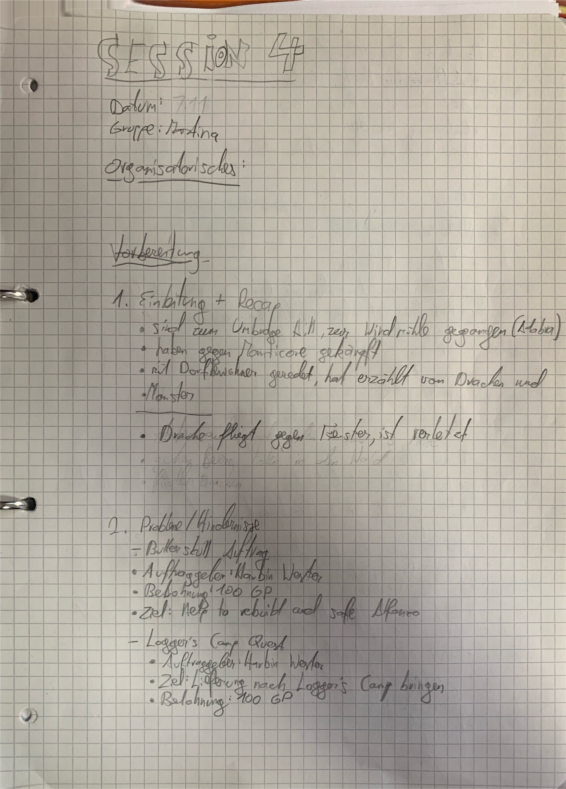
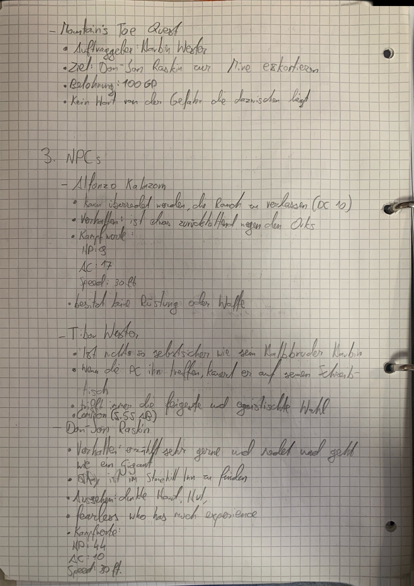
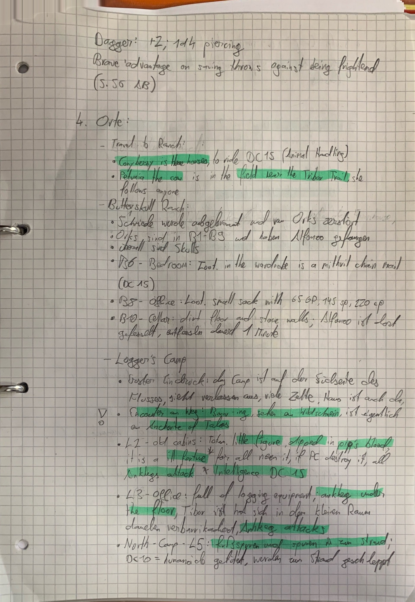
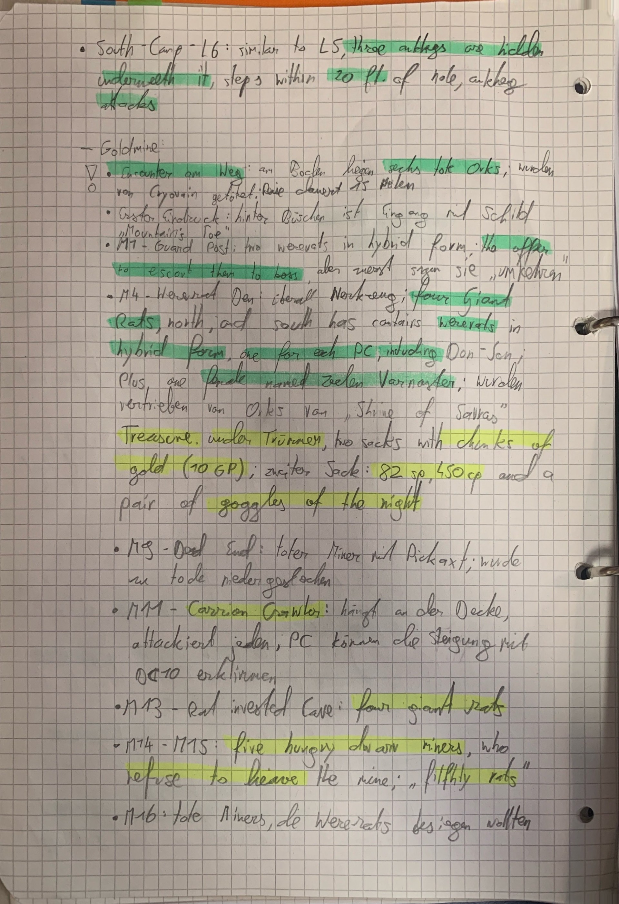
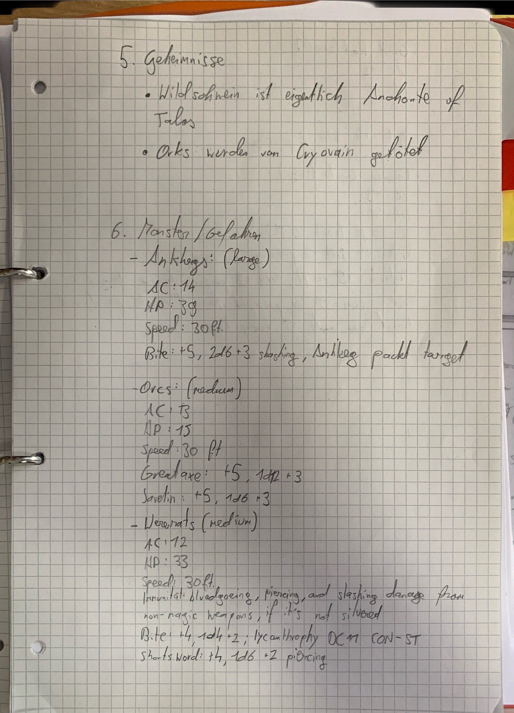
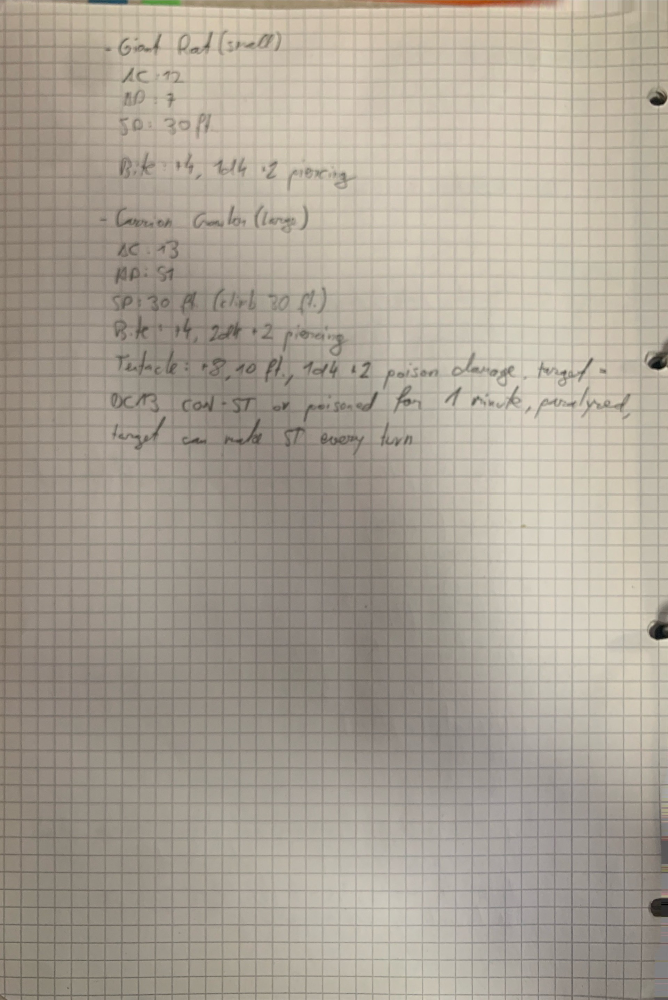

# Notizen für Dungeon Master

Ich habe oft im Internet nach Websiten gesucht, wo andere Spielleiter ihre Notizen teilen. Ich habe aber nicht sehr viel Brauchbares gefunden. Auch in YouTube Videos kamen oft nur Erklärungen für Live-Notizen, also die Notizen, die man sich während dem Spiel mitschreibt. Aber nichts von Vorbereitung. Bis dann vor ein paar Tagen ein Video von dem YoutTube-Kanal “Mit Vorteil” rausgekommen ist. Im Video erklären sie die wichtigsten Sachen für einen Dungeon Master und sie thematisieren auch Vorbereitung sowie Notizen. 

Link zum Video: 

[Gib mir 20 Minuten und du kannst jedes Rollenspiel leiten!](https://www.youtube.com/watch?v=0UaHZYzB2kw)

Dieser Artikel ist dazu gemacht, das ich meine Notizen teile, das andere Spielleiter oder Spielleiterinnen immer die Chance haben, eine Referenz zu haben. Hier ist ein Schema von der Strukturierung meiner Vorbereitungs-Notizen:x

**D&D Session Template**

**Einleitung + Recap**

**…**

**Probleme/Hindernisse**

Butterskull Ranch

- Auftrag: Alfonzo befreien & Tiere zurückbringen
- Belohnung: 50 GP
- Auftraggeber: Habrin Wester

Butterskull Ranch

- Ziel: Alfonzo befreien & Tiere zurückbringen
- Belohnung: 50 GP

Butterskull Ranch

- Ziel: Alfonzo befreien & Tiere zurückbringen
- Belohnung: 50 GP

**NPCs**

Alfonzo

- Rolle:
- Motivation:
- Verhalten:
- Merkmale
- Sonstiges:

Alfonzo

- Rolle:
- Motivation:
- Verhalten:
- Merkmale
- Sonstiges:

Alfonzo

- Rolle:
- Motivation:
- Verhalten:
- Merkmale
- Sonstiges:

**Orte**

Farmhouse (Butterskull Ranch)

- Das zweistöckige Blockhaus wurde von Orks abgebrannt und zerstört
- Orks sind in B1-B9 und haben Alfonzo gefangen
- B6: Loot. Schatulle mit Schmuck (50 GP)
- B10: Alfonoz gefesselt

Goldmine

- Sieht verlassen aus
- …
- C6: Loot. Wagen voller Gold (300 GP)
- C7: Bär

**Monster/Gefahren**

Orks

- HP: 15
- AC
- Axt: 1d8 +6

Bär

- HP: 15
- AC
- Biss: 1d4 +2

**Geheimnisse**

- hinter der Tür (B6; Butterskull Ranch) befindet sich geheimer Eingang zu Dungeon
- Harbin Wester weiß Weg zu Icespire Hold
- …

Manchmal mache ich natürlich auch Abwandlungen oder lasse unwichtige Sachen weg, aber so sind meine Notizen strukturiert. Als Referenz gibt es auch meine Notizen als Bilder, falls ihr sie sehen wollt.

Es sieht sehr aus, was es auch ist, aber es hilft einem echt sehr. Man merkt sich die Sachen auch viel besser, wenn man sie aufschreibt. Die Wichtigen Sachen habe ich mir, vorallem bei den Orten, farbig markiert, um sie nicht zu vergessen. Ich hoffe jetzt, dass ich für die nächste Session gut vorbereitet bin!